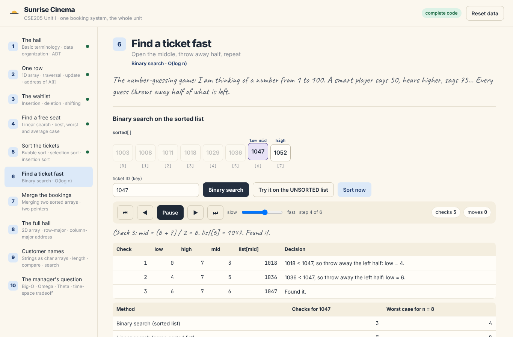

# Sunrise Cinema: CSE205 Unit I as one live project

A complete booking system for a cinema, built in C++ with plain arrays, served to a web page that animates every algorithm step by step. One 2-hour online class covers the whole of Unit I, and students build the C++ modules alongside the teacher.

| Stage | Cinema problem | Unit I topic | Student file |
| --- | --- | --- | --- |
| 1 | What is a seat, a row, a hall? | Terminology, data organization, ADT | (no code) |
| 2 | Book a seat, count free seats | 1D array, traversal, address of A[i] | `seat_row.cpp` |
| 3 | Someone joins or leaves the waitlist | Insertion and deletion with shifting | `waitlist.cpp` |
| 4 | Find the first free seat | Linear search | `search.cpp` |
| 5 | Put ticket IDs in order | Bubble, selection, insertion sort | `sorting.cpp` |
| 6 | Find ticket 1047 fast | Binary search | `search.cpp` |
| 7 | Combine online and counter bookings | Merging two sorted arrays | `merging.cpp` |
| 8 | The full hall | 2D array, row-major and column-major address | `hall.cpp` |
| 9 | Store and find customer names | Strings as char arrays | `customer_names.cpp` |
| 10 | Why does it slow down at 1000 tickets? | Big-O, Omega, Theta, time-space tradeoff | `complexity.cpp` |



## How it works

```
 browser (web/)  ──HTTP/JSON──►  C++ server (server/)  ──calls──►  student modules (src/ or starter/src/)
   animates the trace              cpp-httplib, one route          plain arrays, beginner style,
   shows the real .cpp file        per operation                   one note...() call per step
```

Every algorithm calls a tiny recorder (`noteVisit`, `noteCompare`, `noteSwap`, ...) each time it does real work. The server sends that recording to the page, which replays it as an animation with live check and move counters. Because the page also shows the `.cpp` file that is actually running, students see their own code drive the animation.

## Quick start

You need `g++` (C++17) and `make`.

```bash
make run          # builds everything, starts http://localhost:8080
make test         # 87 automatic checks, grouped by stage
make cli          # console version: prints every checkpoint output
```

Student mode uses `starter/src/`, where every function body is a list of TODOs:

```bash
make starter-run   # same web page, running the students' code
make starter-test  # progress: "Stage 3 waitlist.cpp 7/11 passed"
```

### Windows

Use one of these, then the commands above work unchanged:

- **WSL (recommended):** `sudo apt install g++ make`, clone inside WSL, open the printed URL in your Windows browser.
- **MSYS2 UCRT64:** install MSYS2, then `pacman -S mingw-w64-ucrt-x86_64-gcc make`, and run from the UCRT64 terminal.
- **No make at all:** `scripts\build_windows.bat` (needs `g++` on PATH), then `build\cinema_server.exe`.

The server needs Windows 10 or later. Older MinGW builds with win32 threads may fail to compile `httplib.h`; MSYS2 UCRT64 g++ works.

## Project layout

```
include/          headers: one per module, plus config.h (all sizes) and step_trace.h (the recorder)
src/              complete module code (teacher answer key)
starter/src/      the same modules with TODO steps (what students fill in class)
support/          step_trace.cpp, shared by both versions
server/           C++ web server: routes, JSON helpers, app state (teacher code)
cli/              console version of all ten stages
tests/            automatic checks for every module
web/              the page: index.html, css/, js/ (one file per stage in js/stages/), fonts/ (bundled, works offline)
third_party/      cpp-httplib (single header, MIT licence)
docs/             teaching guide, student guide, API, architecture, homework, style guide
scripts/          Windows build script
```

## Documents

- [docs/teaching_guide.md](docs/teaching_guide.md): minute-by-minute plan for the 2-hour class, with checkpoints and engagement prompts
- [docs/student_guide.md](docs/student_guide.md): setup and the TODO workflow, written for students
- [docs/homework.md](docs/homework.md): problems with test cases only
- [docs/api.md](docs/api.md): every server endpoint and its JSON
- [docs/architecture.md](docs/architecture.md): how the pieces fit, and how to add a stage
- [docs/style_guide.md](docs/style_guide.md): the beginner C++ rules every module follows
- [docs/expected_cli_output.txt](docs/expected_cli_output.txt): the full console run, every checkpoint

## Code rules (student modules)

Plain C arrays only (no `vector` or other STL containers), plain `int`, one statement per line, braces on their own lines, spelled-out names, `i = i + 1`, a comment on every line. Server and web code are teacher-provided and may use normal C++ and JavaScript.

Author: Rohit Bharti, School of Computer Science and Engineering, Lovely Professional University.
