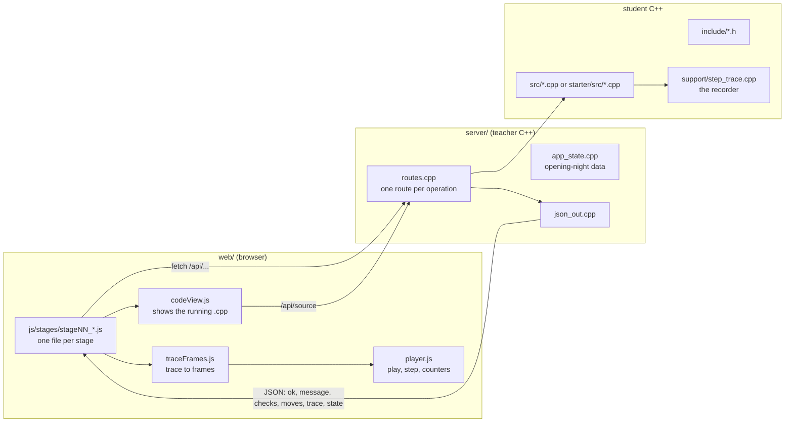

# Architecture

## The three layers

1. **Student modules** know nothing about the web. They take plain arrays, do the work, return a value, and call one `note...()` per unit of work.
2. **The server** owns the cinema's data (`AppState`), calls `resetTrace()`, calls one module function, and sends back the result, the counters and the full step list.
3. **The page** replays the step list on its own copy of the data. The animation is therefore exactly what the C++ did, step for step; nothing is simulated in JavaScript.

## Why the recorder design

- Students add one line per step (`noteCompare(i, i + 1);`) instead of learning callbacks or classes.
- The same calls drive three things: the animation, the live counters, and the exact counts asserted in `tests/`.
- Checks and moves are counted separately because the course compares both (selection sort: many comparisons, few swaps).

## Build modes

| Command | Module folder | Output folder | Badge on page |
| --- | --- | --- | --- |
| `make`, `make run` | `src/` | `build/` | complete code |
| `make starter-run` | `starter/src/` | `build/starter/` | starter code (students) |

The server is compiled with `-DSOURCE_DIR` and `-DSERVER_MODE`, so the code viewer always shows the folder that was actually compiled.

## Adding a stage

1. Header in `include/`, implementation in `src/`, TODO version in `starter/src/`.
2. Checks in `tests/test_modules.cpp`.
3. Route in `server/routes.cpp`; document it in `api.md`.
4. `web/js/stages/stageNN_name.js` exporting `{ number, title, subtitle, topic, story, mount }`, listed in `web/js/stages/index.js`.
5. New module file: add it to `MODULES` in the Makefile, `isAllowedSource` in `routes.cpp`, and `scripts/build_windows.bat`.

## Security notes

The server listens on `127.0.0.1` only. `/api/source` serves only the eight whitelisted module names, never arbitrary paths. All input numbers are range-checked before they reach a module, and list inputs are capped at the array sizes in `config.h`.
